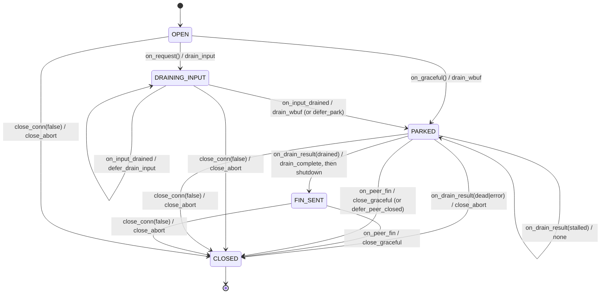

# close_fsm — extract the graceful-close protocol

Status: **implemented** · 2026-11-09.

## Context

The close protocol is the single most fragile part of `include/tcp-server-mt.h`. Nine
rounds of review, a reproduced use-after-free, and a bad_alloc-on-close all trace to
this path. Its state is ten fields of `connection` (377–536) and its transitions are
nine methods of `sub_reactor` (close_conn 2282, park_close 2310, drain_input_then_close
2373, finish_peer_closed 1968, try_begin_write_shutdown 1926, teardown_closed 2470,
discard_pending_output 2249, finish_close 2536, flush_close_callbacks 2543). There is
no single interface: to reason about one close you must hold the whole struct and the
whole reactor in your head.

This spec defines `close_fsm`, a **pure state machine** that owns the close state and
*decides* the next action; the reactor performs the action and feeds the result back.

## Goals / non-goals

**Goals**

- Concentrate the close invariants (the `fin_sent`-vs-`closing` split, the one-round
  deferral, the `close_input_bytes` budget, the linger deadline) behind one small seam.
- Make the close protocol unit-testable without a live socket.
- Make the reactor's nine close methods thin callers of one state machine.

**Non-goals**

- No change to wire behaviour: FIN-vs-RST, mid-close reads, and counter closure stay
  identical. `close_semantics` must pass unchanged.
- No change to the event loop, the frame protocol, the rx/tx halves, or the task queue
  mechanism.
- No change to the public API (`close_connection`, `stop_gracefully`, `send_to`, stats).

## Constraints (non-negotiable)

1. **`noexcept`.** Every transition is `noexcept`; no exceptions.
2. **No allocation.** The FSM's transitions must not heap-allocate. The close path "is
   the one that gets walked when memory is tight" — the one allocation it needs (the
   deferred-callback entry) stays in the reactor, already guarded by `try/catch`.
3. **Thread contract.** Non-atomic FSM state is reactor-thread-only. The cross-thread
   atomics `close_requests`, `is_closed` (and `pending_bytes`, which the FSM only
   reads) keep their current visibility.
4. **One owner.** One reactor thread owns a `close_fsm`, exactly as it owns the
   connection today.

## The module

`close_fsm` is a struct nested in (or owned by) `connection`. It replaces the ten
close fields and the decision logic in the nine methods.

### State it owns

| field | type | replaces |
|---|---|---|
| `closing` | `std::atomic<bool>` | `connection::closing` |
| `close_requests` | `std::atomic<uint32_t>` | `connection::close_requests` |
| `fin_sent` | `bool` | `connection::fin_sent` |
| `deferred_round` | `enum { none, close, peer_closed }` | `connection::deferred_round` |
| `close_input_bytes` | `int64_t` | `connection::close_input_bytes` |
| `close_started_at_ms` | `int64_t` | `connection::close_started_at_ms` |
| `fin_sent_at_ms` | `int64_t` | `connection::fin_sent_at_ms` |
| `is_closed` | `std::atomic<bool>` | `connection::is_closed` |

The cross-thread atomics `close_requests` and `is_closed` move into the FSM but keep
their atomicity and memory orders; `pending_bytes` stays on `connection` (the FSM
reads it, never writes it).

### Read-only view

The FSM holds non-owning pointers to the three things it reads to decide:

- `wbuf` — emptiness gates the FIN (`try_begin_write_shutdown` refuses to FIN over
  bytes still in `wbuf`).
- `rbuf` — readable bytes decide whether input is still owed.
- `pending_bytes` — non-zero means replies are still queued behind the close.

Reading these is a pure observation, so this stays consistent with "decide, don't
act". The FSM never writes them; the reactor owns all mutation.

## Interface

```cpp
enum class close_action {
    none,
    drain_input,         // serve buffered input (run handle_read)
    drain_wbuf,          // move wbuf into the kernel
    drain_complete,      // wbuf drained empty: the close decision is next
    send_fin,            // shutdown(SHUT_WR)
    defer_drain_input,   // queue one more input-serving round
    defer_park,          // queue one park round (replies land first)
    defer_peer_closed,   // queue one peer-closed round
    close_graceful,      // teardown, orderly
    close_abort,         // teardown, RST
};

class close_fsm {
  public:
    close_action on_request();                              // public close / stop_gracefully
    close_action on_graceful();                             // internal graceful close
    close_action on_input_drained(int served, int64_t dealt);
    close_action on_input_defer_failed();                   // after the input-defer hand-off failed
    close_action on_drain_result(drain_outcome r);
    close_action on_peer_fin();
};
```

`drain_outcome` is reused unchanged: `drained / stalled / dead / error`. The
shutdown result, the linger deadline, and the abort path do not have their own
FSM events: `try_begin_write_shutdown` and `close_conn(..., graceful=false)` are
reactor effects, not decisions, so they are called inline by the reactor rather
than returned as an action.

## State machine



### Transition table

| state | event | action | next state |
|---|---|---|---|
| OPEN | `on_request()` | `drain_input` (or `drain_wbuf` if rbuf empty) | DRAINING_INPUT (or PARKED) |
| OPEN | `on_graceful()` | `drain_wbuf` | PARKED |
| DRAINING_INPUT | `on_input_drained(served>0, more buffered, budget left)` | `defer_drain_input` | DRAINING_INPUT |
| DRAINING_INPUT | `on_input_drained(served==0, pending_bytes>0)` | `defer_park` | PARKED |
| DRAINING_INPUT | `on_input_drained(otherwise)` | `drain_wbuf` | PARKED |
| PARKED | `on_drain_result(stalled)` | `none` (EPOLLOUT resumes) | PARKED |
| PARKED | `on_drain_result(drained)` | `drain_complete` (reactor then `shutdown`; on failure the linger deadline ends it) | FIN_SENT or PARKED |
| PARKED | `on_drain_result(dead \| error)` | `close_abort` | CLOSED |
| PARKED | `on_peer_fin()` with wbuf non-empty | `none` (drop read interest, handle_write resumes) | PARKED |
| PARKED | `on_peer_fin()` with wbuf empty, `pending_bytes>0`, first time | `defer_peer_closed` | PARKED |
| PARKED | `on_peer_fin()` with closing and nothing owed | `send_fin` | FIN_SENT |
| PARKED | `on_peer_fin()` otherwise | `close_graceful` | CLOSED |
| FIN_SENT | `on_peer_fin()` | `close_graceful` | CLOSED |

The `on_peer_fin()` rows condense `finish_peer_closed`: the epoll
interest-registration dance that parks a half-closed connection is a reactor effect,
not an FSM decision — the FSM returns `none`, and the reactor keeps the exact epoll
handling (including the `ENOENT` recovery path). The linger deadline and the abort
path (`close_conn(..., graceful=false)`) are reactor effects too, not FSM events.

## Reactor contract

Each action maps to one reactor effect. The FSM decides **which**; the reactor does
**it** and feeds the result back.

| action | reactor does |
|---|---|
| `none` | nothing; the next event comes from epoll/tick |
| `drain_input` | run `handle_read` (with its read/frame budgets); feed `on_input_drained(served, dealt)` |
| `drain_wbuf` | `drain_wbuf_to_socket`; feed `on_drain_result(...)`; arm EPOLLOUT on `stalled` |
| `drain_complete` | wbuf is empty: `try_begin_write_shutdown` (park_close) or the peer_closed/closing decision (handle_write) |
| `send_fin` | `shutdown(fd, SHUT_WR)`; `disarm_write` on success |
| `defer_drain_input` | enqueue `drain_input_task{id}`; on queue-full, re-decide via `on_input_defer_failed` |
| `defer_park` | enqueue `park_close_task{id}`; on queue-full, park now |
| `defer_peer_closed` | enqueue `finish_peer_closed_task{id}`; on queue-full, teardown |
| `close_graceful` | `teardown_closed(..., graceful=true)` |
| `close_abort` | `teardown_closed(..., graceful=false)` (RST via `SO_LINGER{1,0}`) |

**Where the side effects stay** (all in the reactor, none in the FSM):

- `unregister_conn` (epoll DEL + fd close), `discard_pending_output` (byte accounting),
  stats bumps (`closed`, `aborted`, `bytes_dropped`, `frames_dropped_on_close`,
  `epoll_ctl_errors`), `on_connection_closed`, `admission.reset()`, and the deferred
  callback queue (`pending_closes_` → `flush_close_callbacks`).

## Migration plan

Extract in slices, keeping `close_semantics` green after every slice. The FSM starts
as a plain struct holding the fields; behaviour moves into it one method at a time.

1. **Introduce `close_fsm`** as a nested struct holding the ten fields (rename nothing
   yet; `connection` delegates to `fsm.closing`, etc.). Pure mechanical move.
2. **Move the pure decisions** — `try_begin_write_shutdown`'s emptiness check, the
   `deferred_round` bookkeeping, the `close_input_bytes` budget, the linger deadline
   — into `on_*` methods that return the action enum. The nine methods become thin
   callers that perform the returned action.
3. **Remove the scattered flags** once no reactor code reads them directly.
4. **Add the unit tests** (below) alongside, and run `verify/run.sh` (plain + ASan +
   TSan) after each slice.

No step changes wire behaviour; `close_semantics`, `idle_semantics`, `ping_pong`,
`backpressure`, and `fault_injection` must pass unchanged throughout.

## Tests

**Surviving (integration, unchanged):** `close_semantics` (FIN-vs-RST, mid-close
reads, counter closure), `idle_semantics`, `ping_pong`, `backpressure`, `fault_injection`.

**New (unit, no socket):** drive `close_fsm` directly with a fake `wbuf`/`rbuf`/
`pending_bytes` view and assert the returned action:

- `on_request` → `drain_input` (empty rbuf is handled by the following `on_input_drained`).
- `on_input_drained(served>0, more buffered, budget left)` → `defer_drain_input`.
- `on_input_drained(served>0, no more buffered)` → `drain_wbuf`.
- `on_input_drained(served==0, pending_bytes>0)` → `defer_park` (one round only).
- `on_input_drained` twice → the one-round rule: no second defer for the same round.
- `on_input_defer_failed` after a `defer_drain_input` enqueue failure → `defer_park` (or `drain_wbuf`/`none` per `deferred_round`).
- `on_drain_result(drained)` → `drain_complete`.
- `on_drain_result(dead)` / `(error)` → `close_abort`.
- `on_peer_fin` with wbuf empty + pending_bytes>0 → `defer_peer_closed` (first time only).
- `on_peer_fin` with closing and nothing owed → `send_fin`.
- `on_peer_fin` otherwise → `close_graceful`.

## Out of scope / follow-ups

- Decomposing the rest of `connection` into rx/tx/close (candidate 2).
- The `pending_bytes` credit ledger (candidate 3).
- Replacing the intrusive read-continuation list (candidate 4).
