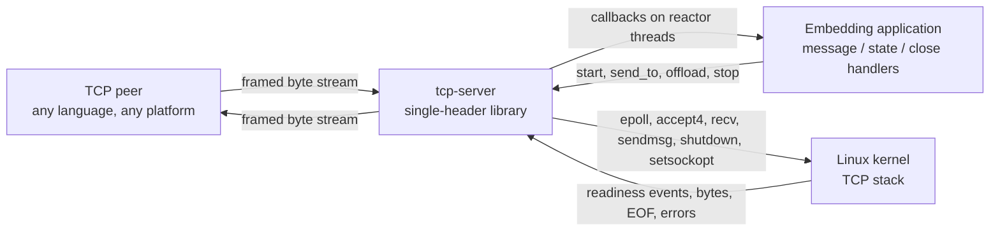
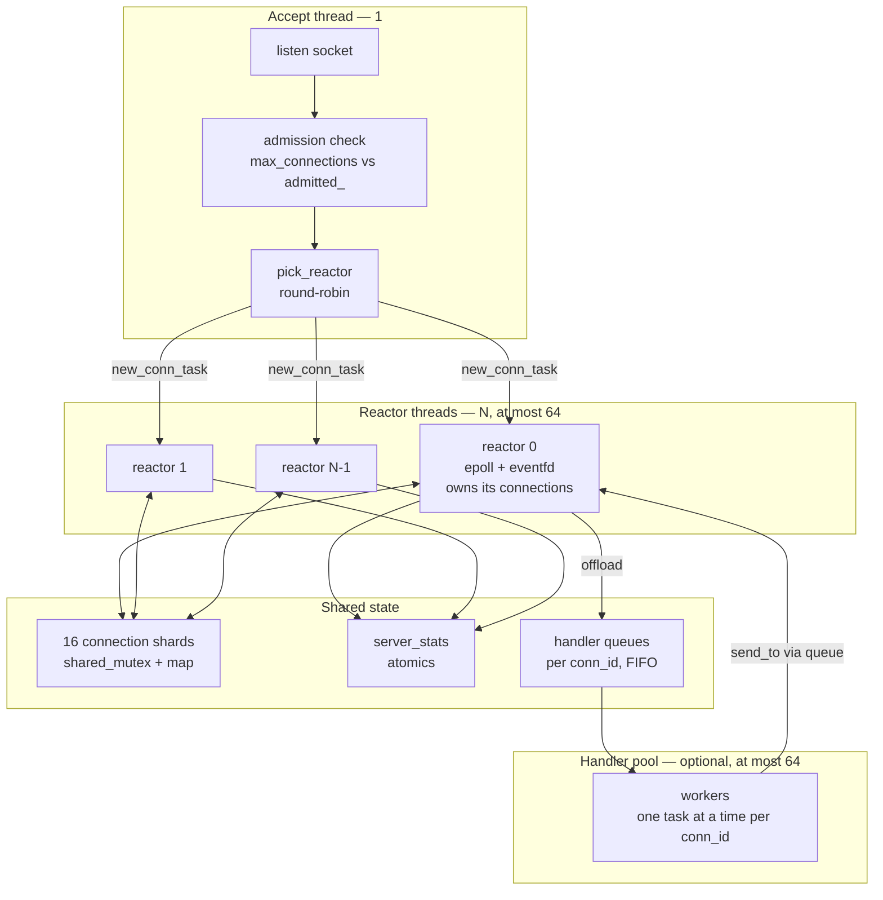
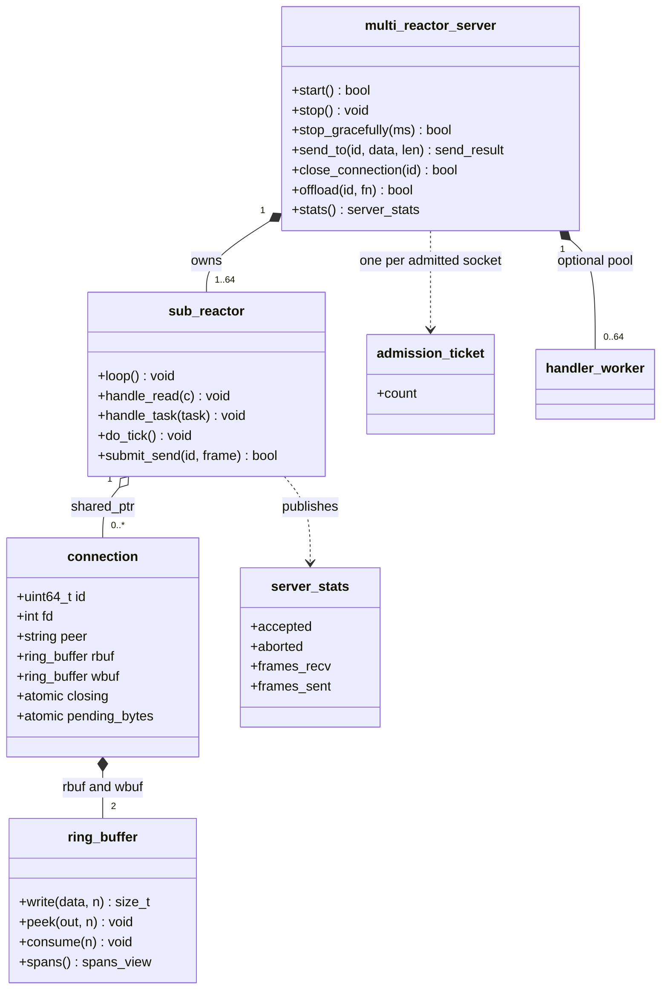

# Architecture Overview

The whole system lives in one header, so "architecture" here means the shape of
the types and threads inside `include/tcp-server-mt.h`, and the rules that keep
them from needing locks on the hot path.

Diagrams use plain Mermaid flowcharts rather than the C4 plugin syntax: the C4
levels are the structure, and flowchart renders everywhere the docs are likely
to be read.

## System context (C4 level 1)

The library sits between a TCP peer and the application that embeds it. It owns
sockets, framing and connection lifetime; it owns nothing about message meaning.

Two boundaries matter. The **wire boundary** is the only place an untrusted
actor can reach: every parse decision, every buffer limit and every timeout
exists there. The **callback boundary** is where application code runs on a
thread the library owns — the source of most of the documented rules about what
a handler may and may not do.

## Container architecture (C4 level 2)

Each reactor is a single-threaded world: its `epoll`, its connections, both ring
buffers per connection and its scratch buffer are touched only by that thread.
The only structures shared between threads are the sharded connection maps (for
lookup by `conn_id`), the per-reactor task queues, the handler pool queues and
the atomic counters.

## Component architecture (C4 level 3)

`admission_ticket` and `fd_guard` are the two RAII types that make accounting
survivable: every failure path releases them through a destructor, so a
descriptor or an admission slot cannot be leaked by an early return.

## Architectural patterns

| Pattern | Where it appears | Why it is there |
|---|---|---|
| **Reactor** | One `epoll` loop per reactor thread, level-triggered | Single-threaded per-connection state removes all per-connection locking |
| **Leader / workers** | Accept thread hands off, never touches connections again | Accept latency is independent of per-connection work |
| **Sharded registry** | 16 `shared_mutex` shards keyed by `conn_id` | `send_to` from any thread needs lookup without a global lock |
| **Staged (two-phase) close** | `closing` flag → drain → FIN → linger → teardown | A frame already accepted is not silently truncated by a close |
| **Whole-frame writes** | `send_to` refuses a partial frame; `wbuf` holds complete frames | The peer never receives a truncated frame from an aborted buffer |
| **Credit-based backpressure** | `pending_bytes` CAS reservation before queueing | Memory is bounded before the frame is copied, not after |
| **Deferred callbacks** | `pending_closes_`, flushed between event batches | Callbacks run with no connection stack frame alive, so `stop()` from one is safe |
| **Batched counters** | Per-reactor tallies published once per loop iteration | One shared atomic per frame cost 18.5% of throughput |

## Key design decisions

**1. Level-triggered `epoll` with an explicit continuation list.**
Ready connections that still have buffered input are appended to an intrusive
list and revisited for at most 64 continuations per iteration, with
`epoll_wait` given a zero timeout while the list is non-empty.
*Rationale*: edge-triggered would make every read path responsible for draining
to `EAGAIN`, and one missed drain would hang a connection forever. The
continuation list keeps the bounded-work property without that failure mode.
*Trade-off*: a connection that always has data can occupy a reactor for up to
64 reads per iteration before other events are examined.

**2. Reactor ownership instead of a thread pool over shared connections.**
*Rationale*: a message handler must be able to read and write connection state
without atomics on every field.
*Trade-off*: a slow handler blocks every connection on its reactor — which is
why the optional offload pool exists, and why `offload` preserves per-connection
ordering.

**3. A single header.**
*Rationale*: deployment is a file copy; there is no ABI to match, no build
system coupling, and the compiler can inline across the whole library.
*Trade-off*: 3,445 lines in one translation unit, and every consumer pays the
parse cost. The file is organised in sections (protocol, RAII, buffers,
connection, reactor, server) to keep navigation possible.

**4. Closing is staged, and `stop()` is the exception.**
*Rationale*: an accepted frame that produced a reply must not lose that reply
because the peer closed its write side. `stop()` deliberately breaks the rule —
it is the operator saying "now", not the peer.
*Trade-off*: a half-closed peer costs a descriptor for up to `close_linger_ms`.

**5. Idle is measured in bytes; frame assembly has its own deadline.**
*Rationale*: a peer dribbling one frame is not idle, and treating it as idle
would kill legitimate slow senders. Splitting the two deadlines means the
slowloris case is bounded by progress, not by silence.
*Trade-off*: two timestamps per connection and two counters to read.

## Module breakdown

| Module | Location in the header | Purpose | Depends on |
|---|---|---|---|
| Protocol | `frame_type`, `write_frame_header`, `encode_frame_into`, `pong_frame` | Wire format, one place that writes byte order | — |
| RAII primitives | `fd_guard`, `admission_ticket` | Exception-safe descriptor and slot accounting | — |
| Buffers | `ring_buffer`, `spans_view` | Fixed-capacity byte ring with wrap-free `sendmsg` spans | — |
| Connection | `connection` | Per-connection state, both buffers, close flags, timestamps | buffers, protocol |
| Reactor | `sub_reactor` | Event loop, framing, write drain, timers, task queue | connection, stats |
| Control plane | `multi_reactor_server` | Lifecycle, acceptance, submission, offload, introspection | reactors, shards, pool |
| Observability | `server_stats` | 20 counters, each tied to a branch | — |

The public contract of the control plane is documented separately in
[`../api-reference.md`](../api-reference.md); this document is about why it is
shaped that way.
