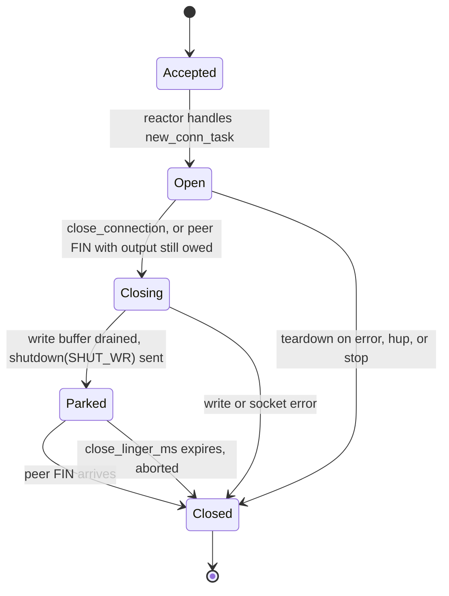
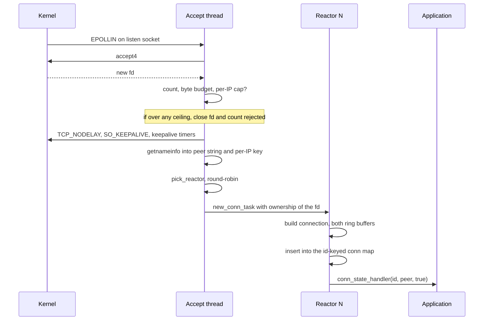
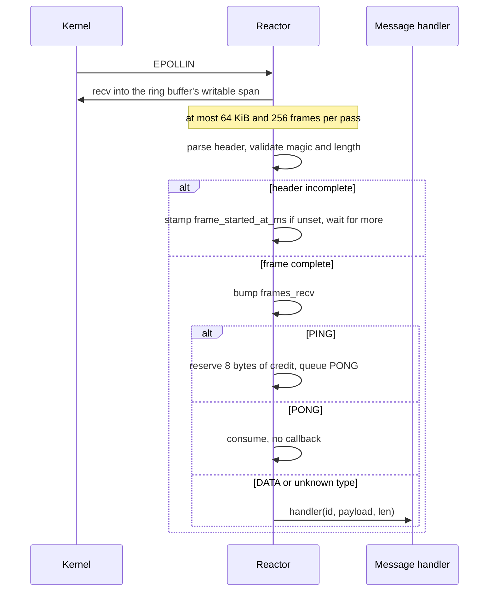
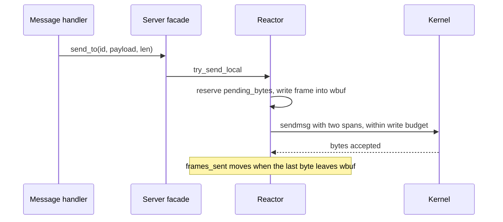
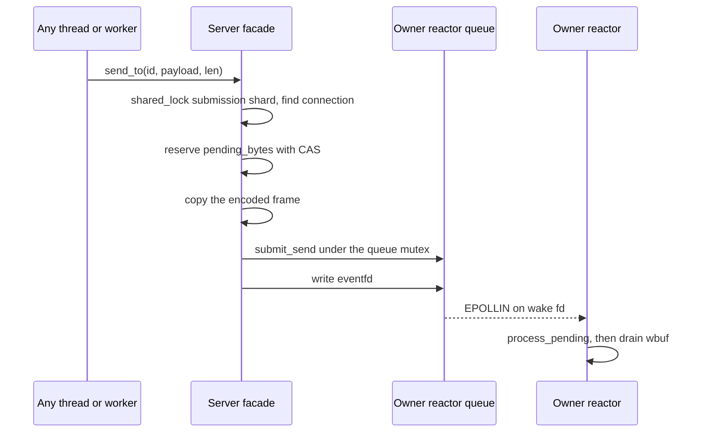
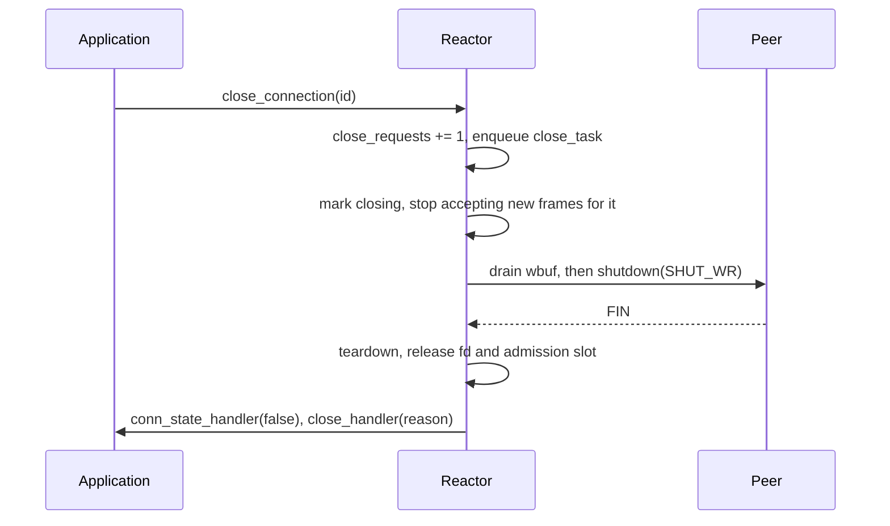
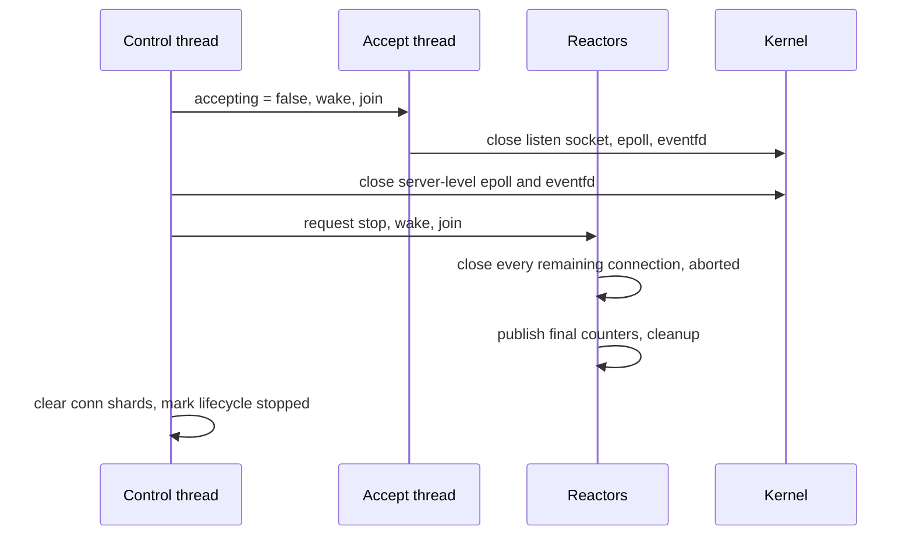
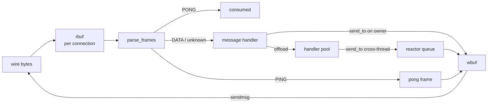

# Workflow Overview

Six flows cover nearly everything the library does: a connection arrives, a
frame is read, a reply leaves, a connection closes, the server shuts down, and
work is offloaded. Each one is single-threaded inside a reactor; the crossings
between threads are marked.

## Connection lifecycle

`Closing` means the application (or the peer) asked to stop and the connection
still owes the peer bytes. `Parked` means our FIN is out and we are waiting for
theirs. Only the last transition runs the application's close callbacks, and it
runs them after the connection's stack frame is gone.

## Workflow 1 — Accepting a connection

The accepting thread hands the descriptor over in a task and keeps no reference
to it. If the target reactor's queue is full, the task is rejected and the
descriptor closed there — the application never learns about a connection it
cannot write to.

## Workflow 2 — Reading a frame

The read loop stops on one of three conditions: the 64 KiB budget, the 256-frame
budget, or a partial frame. In the first two cases the connection is appended to
the continuation list and revisited after the current event batch — with a zero
timeout on `epoll_wait` — so a busy peer cannot starve the rest of the reactor
beyond one bounded batch.

## Workflow 3 — Replying from the owning reactor

This is the common echo shape, and the fastest path in the library: no queue, no
lock, no wakeup.

If the write buffer cannot take the whole frame, `send_to` returns `overloaded`
rather than writing a partial frame; the connection stays open and the peer
receives nothing of that call.

## Workflow 4 — Replying from another thread

Two rules make this safe. The submission shard lock is held across the
lookup-plus-enqueue, so `stop()` cannot clear the map underneath a sender. And
`pending_bytes` is reserved before the copy, so memory is bounded even if the
queue is what fails.

## Workflow 5 — Graceful close

`close_linger_ms` is the budget for the whole close, counted from the park: a
peer that never sends its FIN — or a drain that never finishes — is aborted,
with `aborted` incremented and the reason `close linger expired`.

The callbacks are deferred: they run in `flush_close_callbacks()` between event
batches, not on the connection's stack. That is what makes `stop()` from a
callback safe, and why destroying the server from one is not.

## Workflow 6 — Shutdown

`stop_gracefully(ms)` is the same sequence preceded by a drain window: stop
accepting, ask every connection to close, poll for up to `ms`, then run the
abortive `stop()`.

## Data flow

## Deadlines and budgets

| Knob | Measures | Effect when exceeded |
|---|---|---|
| `idle_timeout_ms` | Time since the last byte received | Connection aborted, `idle_timeouts` |
| `frame_assembly_timeout_ms` | Time since the first byte of the current frame | Connection aborted, `frame_assembly_timeouts` |
| `close_linger_ms` | Time since the close was parked (drain + FIN + peer's FIN) | Connection aborted, `aborted` |
| `tick_ms` | Granularity of all three deadlines | A deadline can fire up to one tick late; `start()` warns |
| `max_pending_bytes` | Bytes accepted but not yet written | `send_to` returns `overloaded` |
| `write_budget_bytes` | Bytes written to one socket per drain | Control returns to the reactor |
| `handler_queue_limit` | Queued offload tasks server-wide | `offload` returns `false` |
| `max_connections` | Admitted plus admitted-but-not-yet-open | New connection closed immediately, `rejected` |
| `max_total_buffer_bytes` | Buffer bytes reserved by admitted connections | New connection closed immediately, `buffer_budget_rejections` |
| `max_connections_per_ip` | Live connections from one numeric peer address | New connection closed immediately, `ip_rejections` |
| `read_high_watermark_bytes` | Pending output for one connection | Reading pauses (EPOLLIN dropped) until the low mark; `read_pauses` |

## Error handling

| Condition | Action | Counter |
|---|---|---|
| Bad magic, over-length frame | Abort with RST | `parse_errors` |
| Ring buffer full with a partial frame | Abort | `parse_errors` |
| `EPOLLERR` | Abort immediately, do not drain | `aborted` |
| `EPOLLHUP` with `EPOLLIN` | Serve the peer's FIN (`recv() == 0`), then close per the FSM | `aborted` only if the socket was broken |
| `EPOLLHUP` with no readable EOF | Abort | `aborted` |
| Pending output above the high watermark | Stop reading at a frame boundary, drop `EPOLLIN` | `read_pauses` |
| Close callback throws | Contained; the connection was already gone | `callback_exceptions` |
| `recv`/`sendmsg` error | Abort | `aborted` |
| `epoll_ctl` registration failure | Abort the connection | `epoll_ctl_errors` |
| `accept4` failure | Continue accepting | `accept_errors` |
| Reactor loop throws | Stop that reactor, mark the server failed | `reactor_failures` |
| Handler throws | Swallowed; connection unaffected | — |
| Close notification cannot be allocated | Connection goes anyway | `close_callbacks_dropped` |

Nothing in the list retries the same operation in a loop. A socket that cannot
be maintained is ended, and the reason string names the syscall that failed, so
the close callback carries the diagnosis to the application.
