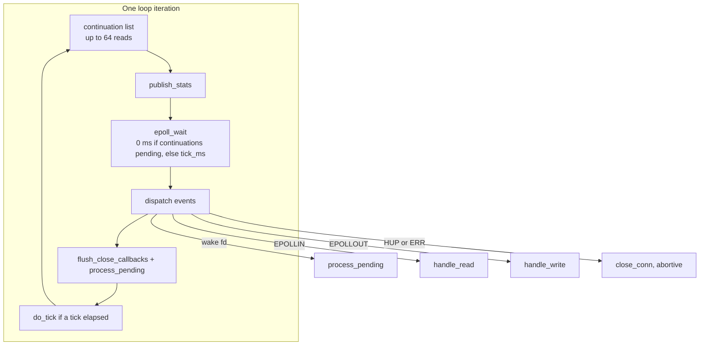

# Deep Dive: Reactor engine and connection lifetime

## Overview

`sub_reactor` is where the library actually runs. One instance per reactor
thread, each owning an `epoll` set, an `eventfd` for cross-thread wakeups, a map
from `conn_id` to `shared_ptr<connection>`, a map from file descriptor to
`connection*`, a 64 KiB scratch buffer, and a task queue guarded by one mutex.

Everything else in the header exists to feed it, configure it, or report on it.

## Responsibilities

- Turn `epoll` readiness into reads, writes and teardowns.
- Assemble frames and enforce both deadlines.
- Answer PING, drop PONG, hand everything else to the application.
- Drain write buffers within a byte budget so no single socket monopolises the
  loop.
- Run timers on a tick: idle, frame assembly, close linger.
- Execute queued tasks from other threads.
- Publish the four traffic counters once per iteration.
- Flush close callbacks only when no connection stack frame is alive.

## Architecture

## Key files

- **`include/tcp-server-mt.h`** — everything: `sub_reactor::loop` (event loop),
  `handle_read` / `parse_frames` (ingest), `handle_write` /
  `drain_wbuf_to_socket` (egress), `do_tick` (timers), `close_conn` /
  `park_close` / `teardown_closed` (lifetime), `process_pending` (task queue).
- **`verify/close_semantics.cpp`** — the suite that pins the close machinery.
- **`verify/backpressure.cpp`** — queue fan-out and the refusal paths.

## Implementation details

### The iteration is bounded on purpose

Each turn of the loop does at most 64 continuation reads, then a single
`epoll_wait`. If continuations are pending the timeout is `0`, so the loop does
not sleep between batches; if none are, the timeout is `tick_ms`. A single
connection that keeps a full ring buffer therefore cannot hold the reactor for
more than one batch before other descriptors are examined.

`epoll_wait` returning `EINTR` simply continues. Any other error marks the
reactor failed rather than retrying: an `epoll` set that cannot be waited on is
not recoverable.

### Read path

`handle_read` receives into the ring buffer's contiguous writable span — no
intermediate stack buffer, so the bytes are copied once, from the kernel. At the
end of the ring the span shrinks to the contiguous remainder and the next `recv`
continues at the wrapped start, so a read is never split across the wrap point.

`parse_frames` then walks complete frames within the budgets (64 KiB and 256
frames per pass) and consumes them one at a time. A header that is only partly
present sets `frame_started_at_ms` once and returns; a frame whose declared
length exceeds the ring buffer is a protocol violation and ends the connection.

### Write path

Writes go through one drain function that builds up to two `iovec`s from the
ring buffer's spans and issues a single `sendmsg(MSG_NOSIGNAL)`. `MSG_NOSIGNAL`
is what keeps a write to a peer that reset from killing the process.

`frames_sent` and `bytes_sent` move when a frame's last byte leaves the ring
buffer for the kernel, not when the frame is queued — an abort that discards
queued output must not leave the counter claiming bytes that never existed.

Two paths reach the drain. On the owning reactor, `send_to` writes directly into
`wbuf` and arms `EPOLLOUT`; from anywhere else the frame is copied and queued,
and the owner drains it after `process_pending`. Both paths count at the same
point, which is why the two cannot disagree.

### Task queue

Cross-thread work is a `std::variant` over six task types — new connection,
send, close, finish-peer-closed, drain-input, park-close — dispatched through a
table built from the variant's own alternative list. A task type without a
handler fails to compile, and a reordered table is not representable.

The queue is per reactor, and its capacity scales with the connections that
reactor can be asked to serve, because a broadcast to every connection lands
entirely on one queue at a time.

### Close machinery

The three closing entry points differ in one thing: who owes what to whom.

- `close_connection` from the application marks `closing`, then drains whatever
  the peer already sent (so its last request is still answered) before the FIN.
- A peer FIN with output still owed parks the connection: ours goes out, then a
  bounded wait for theirs.
- An error path skips all of it and requests RST through `SO_LINGER{1,0}`, on
  the grounds that a half-processed stream is worse than a reset.

Every terminal transition funnels into `teardown_closed`, which unschedules the
descriptor, removes it from both maps, deletes it from the `epoll` set, closes
it, and appends a `closed_conn` record. The callback itself runs later, in
`flush_close_callbacks`, from a batch swapped out of `pending_closes_` — that
swap is why a callback can call `stop()` without the connection's destructor
running underneath it.

### Failure handling inside the loop

A throw from anywhere in the iteration is caught at loop scope: the reactor
counts `reactor_failures`, raises the server's failed flag, stops accepting
submissions, runs `cleanup()`, and exits. The lifecycle state is deliberately
left alone, so a concurrent `start()` verdict is never rewritten by a worker
crash.

## Dependencies

- **Internal**: `connection`, `ring_buffer`, `server_stats`, `multi_reactor_server`.
- **External**: `epoll`, `eventfd`, `accept4`, `recv`, `sendmsg`, `shutdown`,
  `setsockopt`, `clock_gettime` via `steady_clock`.

## Testing

`verify/close_semantics.cpp` is the suite for this component: it drives FIN and
RST sequences, close under write backpressure, half-close, counter accuracy and
`stop_gracefully`. `verify/backpressure.cpp` forces queue-full and credit-limit
refusals. `verify/reactor_spread.cpp` asserts that connections land on distinct
reactors. See [`verification.md`](verification.md).

## Known gaps

These were found in review and are not fixed at the time of writing. They are
recorded here because a reader of this document is likely to be the person who
fixes them.

1. **Allocation inside `noexcept` functions terminates the process.**
   `do_tick` builds three vectors of `shared_ptr` per tick, `handler_worker`
   inserts into a set and a deque, and `stop_gracefully` snapshots connection
   ids. All three are `noexcept` and none of them guards the allocation, so a
   `bad_alloc` there ends the whole process instead of one connection or one
   task.
2. **`offload` can return `false` after the task was queued.** The push into the
   per-connection queue, the queue counter increment and the ready-list append
   are not rolled back if the last one throws. The task stays queued with no
   worker scheduled for it, and later tasks for the same connection queue behind
   it.
3. **`stop_gracefully` can report success after an abort.** Its `drained` flag
   only checks that the connection table and the admission count are empty,
   which a linger-expired abort satisfies as well. `stats().aborted` is the only
   signal that distinguishes the two.
4. **The `RLIMIT_NOFILE` budget under-counts descriptors.** It assumes
   `max_connections + 64`, but each reactor needs two descriptors of its own, so
   at high reactor counts the warning can stay silent while the process cannot
   serve the configured connections.

## Potential improvements

- Replace the three tick vectors with reused members, which removes both the
  per-tick allocation and the terminate risk in one change.
- Make the close notification path allocation-free by reserving capacity when a
  connection is admitted, rather than when it closes.
- Give `stop_gracefully` a tri-state result, or a separate `aborted_during_drain`
  flag, so callers can tell "clean" from "forced" without reading counters.
