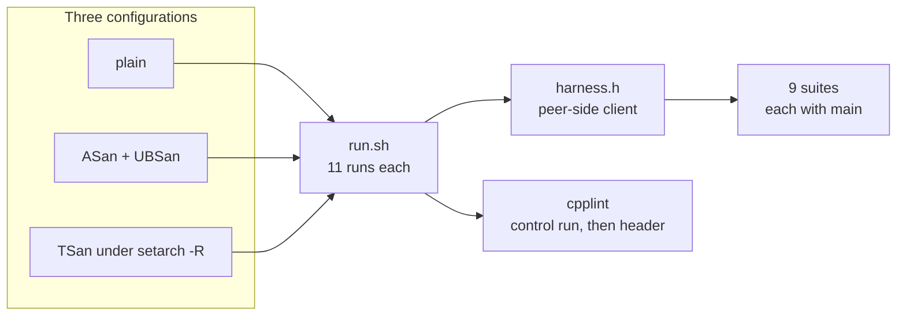

# Deep Dive: Verification

## Overview

The header's behaviour is not checkable by a compiler. Race conditions, close
ordering, backpressure and kernel event semantics only fail at run time, on a
kernel that can express them. This component — `verify/` plus the runner — is
therefore the only evidence that the library works, and it is treated as part of
the product rather than as scaffolding.

`verify/run.sh` is the authority. `CMakeLists.txt` mirrors it for IDEs and
`ctest`; it is a convenience, not a second definition of "verified".

## Responsibilities

- Compile and run every standing suite under three configurations.
- Lint the header at 80 columns, and prove the linter works before trusting a
  clean result.
- Bound every run in time, so a hang presents as a failure.
- Provide a shared peer-side client, so each suite tests the server and not its
  own socket code.

## Architecture



## Key files

| File | Role |
|---|---|
| `verify/run.sh` | The gate: builds each configuration, runs every case with a 180 s timeout, runs cpplint |
| `verify/harness.h` | Peer side shared by all suites: connect, send, split writes, expect a frame, FIN/RST, raw sockets |
| `verify/*.cpp` | Nine suites and four benchmarks |
| `verify/evidence/` | Fifteen one-off probes, written to settle a single claim; not part of CI |
| `CMakeLists.txt` | INTERFACE target plus 11 `ctest` entries mirroring the suite |
| `.github/workflows/c-cpp.yml` | Runs the same three configurations on every push and PR |

## The standing suites

| Suite | What it pins |
|---|---|
| `close_semantics` | FIN and RST sequences, close under write backpressure, half-close, counter accuracy, `stop_gracefully` |
| `idle_semantics` | Idle measured in bytes, a dribbled partial frame not counting as idle, the assembly deadline |
| `ping_pong` | PING answered while healthy and while closing |
| `send_results` | Every `send_result` value, descriptor exhaustion, HUP/ERR delivery, offload ordering and limits |
| `backpressure` | Reactor queue fan-out, close requests dropped when the queue is full |
| `fault_injection` | Worker and accept exceptions, restart after failure, rejected configuration, message handler throws |
| `reactor_spread` | Round-robin placement, and that it follows the configured reactor count |
| `config_budget` | Default buffer budget, new admission/watermark validation, ring buffer commit behaviour |
| `watermark` | Pausing at the high mark, resuming at the low mark, close overrides the pause, assembly-deadline and idle exemptions |
| `hardening` | Unique ids under churn, close-callback containment, global byte budget, per-IP cap, opt-in `SO_REUSEPORT` |
| `harness_selftest` | The harness itself: send, split, FIN, RST, timeout, raw sockets |

Two suites run twice — `close_semantics` at one reactor and at the default, and
`reactor_spread` at four and at two. A single-reactor run averages away a fault
that belongs to one worker, which is why both counts exist.

## What each configuration can catch

| Configuration | Catches |
|---|---|
| plain | Logic, ordering, protocol and counter errors |
| ASan + UBSan | Use-after-free, out-of-bounds, unaligned or overflowing arithmetic |
| TSan | Data races across reactors, queues, shards and the handler pool |

ASan and TSan cannot be linked into one binary, so they are separate builds —
and slow enough that folding them into the default pass would stop people
running it.

## How a suite is written

A suite is a `main()` that returns non-zero on failure and prints one line per
case. The peer side comes from `harness.h`, which exists because six suites had
each grown their own slightly different client, and a bug in any of them reads
as a bug in the server.

The harness is itself tested. `harness_selftest` covers a frame split across
several writes, a FIN, an RST, a read timeout and a raw socket. It does not yet
cover two frames arriving in one `recv`, which is a known blind spot: the
expectation helper reads into a local buffer and can drop a trailing frame.

## Running it

```bash
bash verify/run.sh                               # plain
ENABLE_ASAN=1 bash verify/run.sh                 # ASan + UBSan
ENABLE_TSAN=1 bash verify/run.sh                 # TSan
ENABLE_ASAN=1 ENABLE_TSAN=1 bash verify/run.sh   # all three

cmake -S . -B build && cmake --build build -j
ctest --test-dir build --output-on-failure
```

## Current state on this machine

The last plain run in this environment passed every suite except
`harness_selftest`, whose case D expects the kernel to deliver an RST for a
bare-socket `SO_LINGER{1,0}` probe. This WSL kernel reports FIN instead: the
same limitation that makes `close_semantics` and `send_results` print `[SKIP]`
for their RST and HUP/ERR cases. It is a property of the host, not a
regression in the header — the CI runner, which has a real kernel, runs those
cases and files the verdict as a workflow annotation.

`cpplint` reports zero findings on the header.

## Benchmarks

Four programs, deliberately outside CI: `bench_rss` (resident memory per idle
connection), `bench_rx` (ingest rate at one, two and four reactors),
`bench_send` (echo round trip at p50 and p99) and `bench_floor` (the same
socket shape with no server in between, as a ceiling). They are driven by
`verify/bench.sh` and `verify/bench_matrix.sh`.

No thresholds are asserted. A shared runner hands its cores to other tenants, so
a number recorded there would fail on someone else's load rather than on a
regression; the numbers are only meaningful against numbers taken on the same
machine minutes earlier.

## Potential improvements

- Add the missing `harness_selftest` case: two frames in one `send_all`, then two
  `expect_frame` calls.
- Move the `noexcept` allocation sites listed in
  [`reactor-engine.md`](reactor-engine.md#known-gaps) under a fault-injection
  test, so the terminate paths become regressions rather than findings.
- Either wire `verify/evidence/` into the runner or mark it clearly as
  historical: several probes no longer compile against the current header.
